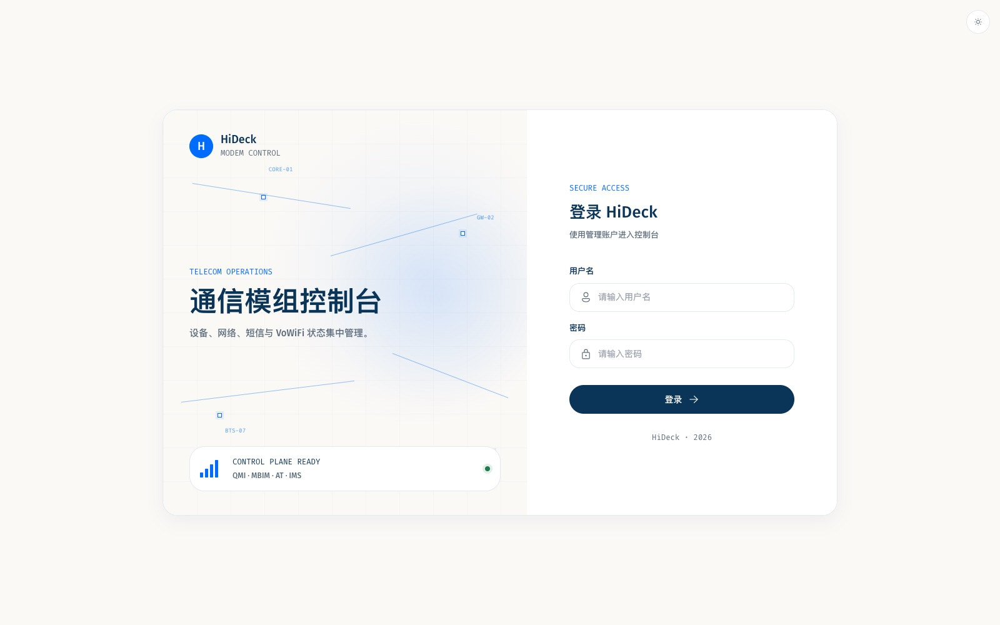
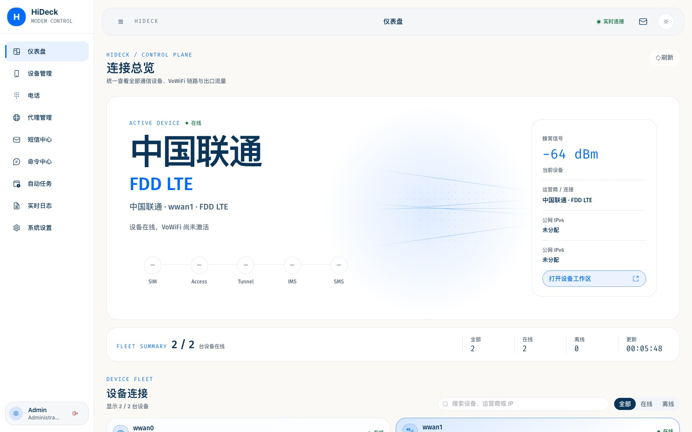
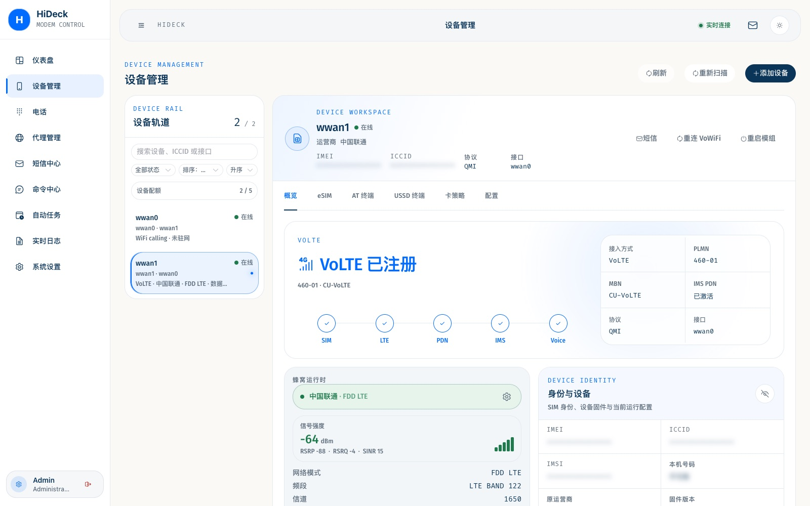
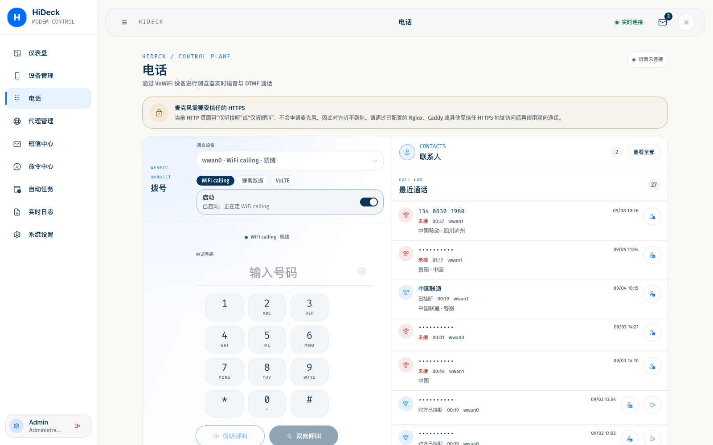
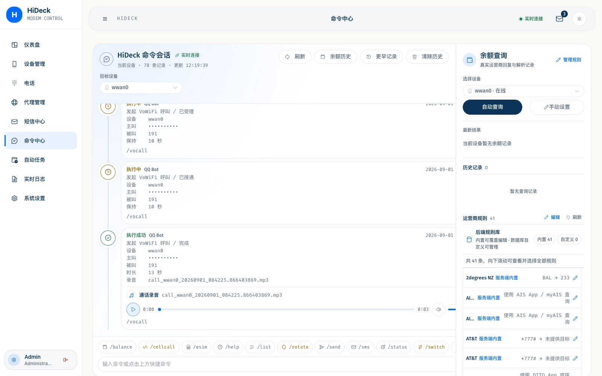
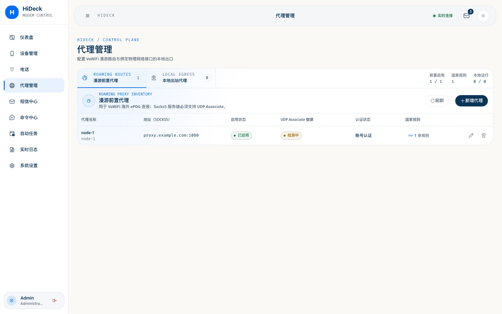

<div align="center">

# HiDeck

**面向高通 4G / LTE / 5G 模组的自托管控制台**

[English](../README.md) · **简体中文** · [日本語](README.ja.md) · [한국어](README.ko.md) · [Español](README.es.md) · [Français](README.fr.md) · [Deutsch](README.de.md) · [Português](README.pt-BR.md) · [Русский](README.ru.md)

<p>
  <a href="https://github.com/yibaiba/hideck/releases/latest"></a>
  <a href="https://hub.docker.com/r/yibaiba/hideck"></a>
  <a href="../go.mod"></a>
  <a href="../web/package.json"></a>
  <a href="../LICENSE"></a>
</p>

</div>

通过浏览器或支持 MCP 的 AI 助手管理 USB 模组、蜂窝代理、短信、WiFi calling / IMS 通话、eSIM 和自动任务。

[下载 v2.1.35](https://github.com/yibaiba/hideck/releases/tag/v2.1.35) · [更新记录](../CHANGELOG.md) · [接入 AI 助手](#mcp--ai-助手)

| | |
| --- | --- |
| Web | `http://YOUR_IP:7575` |
| 默认账号 | `admin` / `admin`（弱密码会要求立刻改） |
| 数据库 | SQLite（`data/hideck.db`） |

## 功能

- **设备** — USB 自动发现；QMI、MBIM、AT、PC/SC；实时射频和卡身份
- **代理** — SOCKS5 / HTTP，用 `SO_BINDTODEVICE` 绑到模组网卡
- **短信** — 收发、会话、联系人；iOS / Google / 三星 / 小米 / 华为 / OPPO / vivo 的 vcf、csv
- **电话** — WiFi calling、蜂窝软件 IMS、原生 VoLTE；保持、呼叫等待、仅听接听
- **VoWiFi** — SWu / IMS、录音；国家代理池、钉死节点或直连
- **原生 VoLTE** — 模组 IMS（`phone_mode=volte`），不建 ePDG；仅国内唯一 MBN 画像才自动选
- **eSIM** — 下载、启用、停用、重命名、删除；激活码或二维码 / PDF
- **MBN 与 SIM 策略** — 运营商配置文件库、自动选择规则、手动试运行
- **自动任务与通知** — 按计划执行；Telegram、邮件、Bark、飞书、企微、微信、QQ
- **MCP** — 125 项工具，覆盖设备、网络、短信、联系人、电话、eSIM、MBN、代理、命令、余额、任务和诊断

协议说明：[VoWiFi](../docs/vowifi-protocol-alignment.md) · [VoLTE](../docs/volte-native.md) · [运营商](../docs/operator-notes.md) · [硬件](../docs/modem-hardware.md) · [模组直拨排障](../docs/modem-voice-troubleshooting.md)

外呼/短信按 SIM 独立限流，重启保留计数：[额度与配置说明](../docs/outbound-limits.md)。

模组运营商配置：[MBN 管理、SIM 策略与手动试运行](../docs/mbn.md)。

WebDAV 备份与本地清理：[归档短信、通话记录与录音](../docs/webdav-archive.md)。

## 快速开始

推荐 Docker。需要 Linux、curl、Compose、host 网络、USB 权限。镜像已带 ADB、ALSA 工具、AMR/MP3 库和内嵌模组语音资源；宿主机仍需 USB 音频驱动，见[模组直拨依赖](../DOCKERHUB.md#module-voice-dependencies)。

```bash
curl -fsSL https://raw.githubusercontent.com/yibaiba/hideck/main/deploy.sh | sh
```

```bash
curl -fsSL https://raw.githubusercontent.com/yibaiba/hideck/main/deploy.sh | HIDECK_DIR=/opt/hideck sh
```

浏览器打开 `http://YOUR_IP:7575`。

公网域名（解析到服务器，放行 `443/TCP` 和 `443/UDP`）：

```bash
curl -fsSL https://raw.githubusercontent.com/yibaiba/hideck/main/deploy.sh | \
  HIDECK_DOMAIN=hideck.example.com \
  HIDECK_DIR=/opt/hideck sh
```

镜像：`yibaiba/hideck:latest`。Compose 使用 `network_mode: host`、`privileged: true`、`/dev`，数据在 `config/`、`data/`、`logs/`。见 [DOCKERHUB.md](../DOCKERHUB.md) 和 [HTTPS / WebRTC](../docs/https-webrtc.md)。

飞牛 fnOS 可从[发布页](https://github.com/yibaiba/hideck/releases/tag/v2.1.35)下载 `hideck_2.1.35_fnos.fpk` 及校验文件，手动安装。包内使用固定版本的 Docker 镜像，提供桌面入口和持久化目录；[安装条件与验证范围](../packaging/fnos/README.md)中列出了仍需真机验收的项目。

```bash
docker compose ps
docker compose logs -f hideck
```

使用 PC/SC USB 读卡器时，还需配置宿主机服务及可选 Compose 覆盖文件，见 [Docker PC/SC 说明](../DOCKERHUB.md#pcsc-smart-card-readers)。

## MCP / AI 助手

HiDeck 内置远程 MCP 服务，采用 Streamable HTTP，与现有 HTTP/HTTPS 共用端口，地址为 `/mcp`，默认关闭。Agent 直接连接已经运行的 HiDeck，无需在 Agent 所在机器另装 HiDeck MCP 服务端。

1. 登录网页并确认当前版本的免责声明，在 **设置 → MCP 接入** 开启服务，创建有明确名称的令牌。明文只显示一次，创建后及时保存。
2. 选择客户端并复制连接配置；也可点击 **复制给 Agent**，让有本机配置权限的 Agent 合并配置，保留原有设置。
3. 使用 Agent 能访问的地址，例如 `http://YOUR_IP:7575/mcp` 或 `https://hideck.example.com/mcp`。重载客户端后，让它列出设备验证连接。

网页提供 **Codex、Claude Code、Cursor、Gemini CLI、Hermes Agent、DeepSeek dsh、Pi Agent、Grok Build** 八种配置模板。客户端版本要求与实际验证范围见 [MCP 接入文档](../docs/mcp.md)和[验证说明](../docs/mcp-validation.md)。

令牌拥有已开放的全部业务权限，可在设置中撤销或删除，不能用于网页登录或 REST 管理接口。125 项工具均提供输入、输出契约和调用说明，写操作不会自动重试；不开放系统升级、卸载、登录凭据和通知密钥配置。

需要网页音频控制通话时，在电话页点击 **连接 MCP**，选择令牌并授权麦克风，保持网页打开。Agent 使用已授权的 `audio_connection_id` 操作通话，音频仍通过网页现有 WebRTC 会话传输。麦克风访问条件见 [HTTPS / WebRTC](../docs/https-webrtc.md)。

设置中的 **检查接入** 可查看服务是否就绪及令牌最近请求、调用记录。工具调用日志在现有 **实时日志** 页面，搜索 `MCP tool` 筛选。鉴权、反向代理排查、工具契约与能力限制见 [MCP 接入文档](../docs/mcp.md)。

## 截图





| 设备 | 电话 |
| --- | --- |
|  |  |

| 命令 | 代理 |
| --- | --- |
|  |  |

## 二进制

安装脚本会补装 ADB、ALSA 和录音依赖，并检查 ADB 能力与宿主机 USB 音频支持。依赖未通过时，即使服务已安装，脚本也会明确报错并返回非零退出码，不会报告完整部署成功；检查不会连接或重启模组。

OpenWrt 默认不装模组直拨依赖，可另装 `hideck-adb` 和 `hideck-modem-voice`。IPK/APK 安装方式及架构匹配见 [OpenWrt 打包说明](../packaging/openwrt/README.md)。

```bash
curl -fsSL https://raw.githubusercontent.com/yibaiba/hideck/main/deploy-binary.sh | sh
```

```bash
curl -fsSL https://raw.githubusercontent.com/yibaiba/hideck/main/deploy-binary.sh | \
  HIDECK_DIR=/opt/hideck \
  HIDECK_VERSION=v2.1.35 \
  HIDECK_ARCH=linux_amd64 sh
```

| 文件 | 平台 |
| --- | --- |
| `hideck_v2.1.35_linux_amd64` | x86_64，glibc + UPX |
| `hideck_v2.1.35_linux_arm64` | ARM64 / 树莓派 OS 64 位，glibc + UPX |
| `hideck_v2.1.35_linux_armv7` | 32 位 ARM，glibc + UPX |
| `hideck_v2.1.35_openwrt_amd64` | OpenWrt x86_64，musl 静态，不压 UPX |
| `hideck_v2.1.35_openwrt_arm64` | OpenWrt aarch64 |
| `hideck_v2.1.35_openwrt_armv7` | OpenWrt 32 位 ARM |
| `hideck_v2.1.35_openwrt_dynamic_amd64` | OpenWrt x86_64，动态 musl，可使用 MP3 编码 |
| `hideck_v2.1.35_openwrt_dynamic_arm64` | OpenWrt aarch64，动态 musl，可使用 MP3 编码 |
| `hideck_v2.1.35_openwrt_dynamic_armv7` | OpenWrt 32 位 ARM，动态 musl，可使用 MP3 编码 |

OpenWrt 只用 `openwrt_*`。包管理附件和二进制安装脚本继续使用静态版本；动态版本需要匹配的运行库，供通话 MP3 录音使用，见 [OpenWrt 打包说明](../packaging/openwrt/README.md#openwrt-dynamic-musl)。

## 配置

复制 [config/config.example.yaml](../config/config.example.yaml) 为 `config/config.yaml`。

| 项 | 默认 | 说明 |
| --- | --- | --- |
| `server.port` | `7575` | HTTP |
| `server.https_enabled` | `false` | 内置 HTTPS；前面有反代时关掉 |
| `server.https_port` | `7576` | 内置 HTTPS 端口 |
| `server.webrtc_udp_address` | `:7580` | WebRTC 音频 UDP |
| `server.webrtc_public_host` | 空 | NAT 后 ICE 公网地址 |
| `web.username` / `web.password` | `admin` | 请立刻改 |
| `vowifi.enabled` | `false` | 全局 VoWiFi |
| `mcp.enabled` | `false` | 远程 MCP；独立令牌在网页设置中管理 |
| `system.openwrt_dynamic_interfaces` | `false` | 仅 OpenWrt |

不要把密钥提交进仓库。SIM PIN 只存环境变量名（`HIDECK_SIM_PIN_READER1`）。`PROXY_WEB_PASSWORD` 优先于配置文件。

## 构建

Go `1.26.4+`，Node.js / npm。`make build-*` 需要 UPX。

```bash
make build-amd64    # 还有 build-arm64、build-armv7、build-all
```

```bash
npm ci --prefix web && npm run build --prefix web
cp -R web/dist internal/web/dist
GOWORK=off CGO_ENABLED=0 GOOS=linux GOARCH=amd64 \
  go build -trimpath -tags "with_utls nomsgpack" -o dist/hideck_linux_amd64 ./cmd/hideck
```

```bash
npm test --prefix web && npm run typecheck --prefix web
go test -timeout=60s ./cmd/... ./internal/... ./pkg/...
```

开发代理：`web/.env.local` 里 `VITE_API_PROXY_TARGET=http://127.0.0.1:7575`。接口文档：`/api/docs`。

## 许可

仅供个人学习、研究和测试，不是生产话务平台。与 Quectel、高通、运营商无官方关系。遵守当地法律和运营商条款。

[PolyForm Noncommercial 1.0.0](../LICENSE)。`third_party/vowifi-go` 为 AGPL-3.0。分发二进制或镜像前阅读 [THIRD_PARTY_NOTICES.md](../THIRD_PARTY_NOTICES.md)。

感谢：[LINUX DO](https://linux.do/) · [iniwex5/vohive-release](https://github.com/iniwex5/vohive-release) · [boa-z/vowifi-go](https://github.com/boa-z/vowifi-go)
